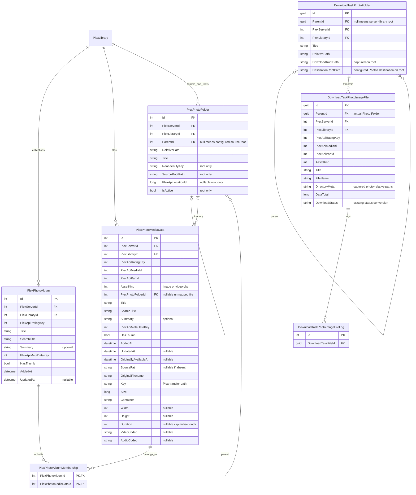

# Photos backend: album collections, physical folders, and Photo Folder downloads

## Execution contract and status

- **Status:** settled backend storage/download design. Optional frontend-facing photo browse APIs are excluded. The approved simplification uses SDK 0.22.3 typed operations, the existing library retrieval contract, and five vertical download-preview slices. Section 11 retains historical verification separately from current requirements.
- **Scope:** backend only: retrieval -> reconciliation -> album/direct-file selection -> preview/create -> transfer and complete lifecycle. Dedicated photo browsing/selection-expansion endpoints and their DTOs are not required and must not be retained unused. Do not edit frontend code, generate frontend clients, modify README/CHANGELOG files, apply migrations to a live/user database, or commit.
- Inspect current source before implementation and preserve unrelated staged/unstaged changes. The original planning baseline was `225021741`; subsequent unreleased work exists and is not a compatibility contract.
- Follow `reaparr-backend`, `reaparr-command-handler-patterns`, and applicable backend test skills. Use operation-specific endpoint slices, contextual logging with `.Here()`, existing Result/cancellation conventions, DI, and native tools. New folders require root namespaces and owning `.csproj.DotSettings` entries.
- Complete implementation and regression-test edits before final validation. Generate schema migrations through EF tooling, not hand-authored schema operations.
- **No backward compatibility for the unreleased photo design.** Replace obsolete models and migrate every current caller/test. Do not retain album download tasks, compatibility aliases, dual hierarchies, or conversion machinery for unreleased queued downloads.
- Other media families retain their behavior. Shared changes require focused coverage for affected consumers.

Related: #625, #690.

## 1. Settled product model

**Albums select. Photo Folders organize. Assets download. Queued paths remain stable.**

| Concept | Responsibility | Not its responsibility |
|---|---|---|
| Album | Flat collection of assets, with many-to-many membership; selectable for download | Download ownership, destination naming, queue parentage |
| Photo Asset | One scoped single-file image or video clip, stored directly in `PlexPhotoMediaData` | A separate metadata wrapper or a collection of file parts |
| Photo Folder | Persistent photo-specific queue group, with aggregate progress and descendant actions | Defining album membership or running its own transfer engine |

Merge `PlexPhotoImage` into `PlexPhotoMediaData`, retaining `PhotoAssetKind` (`Image`, `VideoClip`). One catalog asset is one file; no asset/part hierarchy. Metadata albums are flat: no album contains itself or another album. A file may belong to several albums, and an album may contain files from several physical folders.

Persist album membership and physical folder placement independently. These relationships support album selection and download placement; they do not require new browsing endpoints or frontend DTOs. Album selections expand to the same deduplicated file identities as direct selection before queue creation.

Do not introduce a generic container/graph engine, closure table, second queue/scheduler, folder/album crosswalk, optional layout modes, offline thumbnail store, or snapshot publication service. Curated albums, playlists, collections, and recommendation hubs are not established metadata-album inputs and remain outside this plan.

### Required download layout

Use `Downloads/Photos` for temporary downloads and the configured photo destination **as-is** for final files. The destination already points to `/Photos`; do not append another category segment. Add the server–library Photo Folder directly beneath each effective root:

```text
Downloads/Photos/
└── Home Plex - Photos/
    ├── portrait.jpg
    ├── birthday.mp4
    └── Trips/
        └── beach.jpg

/Photos/  (configured destination)
└── Home Plex - Photos/
    ├── portrait.jpg
    ├── birthday.mp4
    └── Trips/
        └── beach.jpg
```

- **Every queued relative path is relative to the server–library Photo Folder.** Flat files have an empty relative directory. Source subfolders retain their relative structure beneath that folder. Absolute source paths never become destination paths.
- Use the existing configured photo destination folder unchanged, not a new setting or hardcoded absolute path. `GetDownloadCategoryDirectory` appends the Photos category only to the temporary download root; `GetDestinationDirectory` starts directly from the configured photo destination. Final path = `<configured-photo-destination>/<server-library>/<relative-folder>/<file>`; never append `Photos` to that destination.
- Derive the readable server–library folder name from server/library names using existing safe-name conventions. Ownership uses server/library IDs, not the name. Disambiguate colliding safe names deterministically with stable IDs rather than merging libraries or overwriting files.
- Reuse the same captured library-root Photo Folder for repeated selections in the same effective download/destination context. A changed destination is a distinct context, not a silent relocation.
- Keep distinct configured source roots separate beneath the library root when a library has multiple roots. Use stable `root-{catalog-root-folder-id}` namespace segments for that case, not response order or source basename. With one configured source root, place its relative content directly beneath the library root. A later configuration change never reparents existing tasks.
- Do not insert album-name directories. Do not create a synthetic album for flat files.

## 2. Evidence and compatibility limits

Historical investigation used **PMS 1.43.4.10903-e5521bd8c**, Linux. Keep private hosts, tokens, account identifiers, and source paths out of this plan and fixtures.

| Historical section | Root assets | Metadata albums | Descendant assets |
|---|---:|---:|---:|
| 10 | 111 | 2 | 17 + 1 |
| 11 | 1 | 0 | 0 |
| 12 | 17 | 0 | 0 |

The section-10 shape contains **129 unique assets**, not 113. Unfiltered `/all` and root `/folder` returned root assets and navigation/container entries; traversal was necessary. These are historical counts, not assertions about a mutable live library.

Observed facts:

- Unfiltered `/library/metadata/99133/children?includeMeta=1` and its `type=13` variant returned the same 17 photos. Use **unfiltered children** so clips are not filtered out. Empty `/allLeaves` does not prove empty `/children`.
- `/library/sections/10/folder?parent=3706` returned those members with `parentRatingKey=99133`; folder token `3706` is not album rating key `99133`.
- Section `Location` entries supplied numeric ID and absolute path. Root paging returned `50 + 50 + 11`; nested paging returned `10 + 7`.
- `/albums` and `/collections` were empty; hubs were dynamic groupings, not verified curated membership.
- No live clip or overlapping-album sample was captured; those require explicitly synthetic fixtures. Multipart input was not observed and is outside the settled single-file model; test explicit rejection rather than claiming support or live acceptance.

Sources:

- [Official PMS API](https://developer.plex.tv/pms/): clip=12, photo=13, photoalbum=14; JSON requires an Accept header.
- [Plex library view](https://support.plex.tv/articles/200392126-using-the-library-view/): folder browsing follows disk layout.
- [Python PlexAPI photo implementation](https://python-plexapi.readthedocs.io/en/latest/_modules/plexapi/photo.html): albums/photos can both report type `photo`; children can include photos and clips.
- [Python PlexAPI library implementation](https://python-plexapi.readthedocs.io/en/latest/_modules/plexapi/library.html): locations expose ID/path; folder keys are followed separately. Client behavior is evidence, not a universal server guarantee.

Preserve these reduced observed shapes through existing inline SDK/HTTP builders, not a new capture framework:

```json
{"MediaContainer":{"size":1,"Directory":[{"key":"10","type":"photo","Location":[{"id":34,"path":"/fixture/photos"}]}]}}
{"MediaContainer":{"offset":0,"size":2,"totalSize":2,"Metadata":[{"ratingKey":"99133","type":"photo","key":"/library/metadata/99133/children","title":"Album A"},{"ratingKey":"99151","type":"photo","key":"/library/metadata/99151/children","title":"Album B"}]}}
{"MediaContainer":{"offset":0,"size":2,"totalSize":2,"Metadata":[{"key":"/library/sections/10/folder?parent=3706","title":"Folder A"},{"ratingKey":"98901","type":"photo","key":"/library/metadata/98901","Media":[{"id":123209,"Part":[{"id":123209,"file":"/fixture/photos/root.jpg","key":"/library/parts/123209/file.JPG"}]}]}]}}
{"MediaContainer":{"offset":0,"size":1,"totalSize":1,"Metadata":[{"ratingKey":"99134","type":"photo","key":"/library/metadata/99134","parentRatingKey":"99133","Media":[{"id":123491,"Part":[{"id":123491,"file":"/fixture/photos/Folder A/child.jpg","key":"/library/parts/123491/file.JPG"}]}]}]}}
```

## 3. Simplified database structure

**Four catalog tables, three queue/log tables.** Do not retain metadata/file wrapper pairs, a separate source-root table, or a folder-membership join.

### Explicit, identity-only entities

- Catalog albums, files and folders use `BaseIdEntity`, supplying only integer `Id`. The current equivalent is named `BaseEntity`; introduce the requested identity-only base without renaming other families. Album membership uses its composite key, not a surrogate ID.
- No photo entity inherits `BasePlexMedia`, `BasePlexMediaData` or `BasePlexMediaQuality`. Declare only the photo fields below. Do not add a new metadata superclass, generic compatibility interface, fake movie defaults or casts back to generic media entities.
- Exclude movie IDs, year/studio/content ratings, theme/art fields, comparison state, generated release names, source heuristics and stored sort/count/size aggregates. Optional description, source timestamps, thumbnail keys and image/clip dimensions remain useful photo data. Transfer bytes belong directly to the file row.
- Keep catalog and queue folders separate: catalog reflects Plex now; queue captures where transfers were placed. They share no deletion FK.

### Catalog: one row per file, roots are folders

| Entity | Responsibility |
|---|---|
| `PlexPhotoAlbum : BaseIdEntity` | Flat metadata collection: scoped rating key, title/search title, optional description, thumbnail identity and source timestamps. |
| `PlexPhotoMediaData : BaseIdEntity` | **The asset itself**, image or clip: scoped rating/media/part keys, kind, display/search/thumbnail metadata, source timestamps/path, one nullable folder FK, original filename, transfer key, size/container and relevant dimensions/clip duration/codecs. No `PlexPhotoId`, child parts, `PartIndex`, separate asset row or version table. |
| `PlexPhotoAlbumMembership` | Composite PK `(PlexPhotoAlbumId, PlexPhotoMediaDataId)`; collections can overlap without duplicating files. |
| `PlexPhotoFolder : BaseIdEntity` | One physical folder tree per configured Location. A row with null `ParentId` **is the configured source root**, not a second entity. All rows have scope, title and canonical source-root-relative path; root rows additionally hold root identity/path/Location ID and active state. |

Root-only columns on `PlexPhotoFolder` are `RootIdentityKey`, `SourceRootPath`, nullable `PlexApiLocationId`, and nullable `IsActive`. Descendants leave them null; a database check constrains valid root/descendant shapes. Root `RelativePath` is empty; descendant paths are nonempty. `ParentId` alone distinguishes roles, so no `IsRoot` flag or subtype table.

Root configuration and physical hierarchy have the same lifetime identity here: retain inactive root rows for stable IDs, while removing/reconciling their children. An empty configured root is simply a folder without children/files. Do not persist a redundant root FK on each file or a root record elsewhere. Locate a folder's root via its parent chain; use recursive queries for batches, not one lookup per file.

**Single-file input contract:** each supported asset supplies exactly one downloadable file. Preserve its Plex media/part IDs as transport identifiers, not separate entities. The earlier multipart and multi-version-group requirements are superseded. If Plex supplies several file representations/parts for one asset, fail the refresh with an explicit unsupported-shape error before publication; never pick the first, flatten several files into one row, or silently discard data. This is a chosen model constraint, not a universal claim about all Plex responses.

### Queue: folder -> file -> logs

| Entity | Responsibility |
|---|---|
| `DownloadTaskPhotoFolder` | Existing task-group conventions, optional parent, captured relative path and root context. Null parent is the server–library Photo Folder; it owns descendants/files directly or through child folders. |
| `DownloadTaskPhotoImageFile` | **The sole photo/clip transfer task**, combining asset identity/display/kind and existing file-transfer state. Required `ParentId` points directly to its actual Photo Folder. No image wrapper and no second folder FK. |
| `DownloadTaskPhotoImageFileLog` | File-scoped log with required `DownloadTaskFileId`; remove image-wrapper and album scope FKs. Folder/server/library log queries join the file/folder hierarchy through existing logging conventions. |

One file has one task ID, one folder parent, one status/progress stream and one set of logs. Folder actions operate on descendant files; a direct asset action targets that file task. The server–library grouping root contains flat files directly. Do not add a file/asset display wrapper or parallel group state.

### Database diagram

The diagram shows the new physical tables and their essential fields. Queue operational fields continue to follow existing transfer/log bases. Nullable/root-only fields are marked; composite uniqueness is defined below, not implied as global rating-key uniqueness.



### Identity, FKs, indexes and counts

- Scoped album and file identities are unique `(PlexLibraryId, PlexApiRatingKey)`. Retain a scoped unique part key `(PlexLibraryId, PlexApiPartId)` as a transport-integrity check. Same keys on another server/library are distinct.
- Membership PK is album-first; reverse index `(PlexPhotoMediaDataId, PlexPhotoAlbumId)` supports file membership/zero-membership tests. Album deletion cascades only edges, never files.
- Root identity uses positive `id:<Location-id>` or canonical `path:posix:<case-preserved-path>` / `path:windows:<invariant-uppercase-drive-or-UNC-path>`. Filtered unique `(PlexLibraryId, RootIdentityKey)` applies to null-parent root rows. Use SQLite `BINARY`, not NATURALSORT, for identity.
- Descendant identity is unique `(ParentId, RelativePath)` for non-null parents. Parent identity disambiguates configured roots without another root ID column. RelativePath uses canonical `/` and source-specific case rules; display `Title` keeps source spelling. Validate expected parent-path relation, same scope and acyclic parentage before writes.
- Browse indexes: folders `(PlexLibraryId, ParentId, Title, Id)`, files `(PlexLibraryId, PlexPhotoFolderId, Title, Id)`, library album/file title indexes `(PlexLibraryId, Title, Id)`, with existing NATURALSORT title collation. Reuse equivalent indexes; inspect query plans before adding more.
- Catalog folder deletion sets file folder FK null, never deletes the file. Child folders cascade; file deletion cascades membership edges. Normal root removal deactivates its root row and clears obsolete descendants/mappings.
- Queue folders use captured server/library/effective-root context for root reuse, a SQLite-safe filtered root uniqueness index and descendant `(ParentId, RelativePath)` uniqueness. Deduplicate file tasks by scoped file identity and captured destination under existing completed/active policies; album membership never changes that identity.
- Index queue file `ParentId`; root/subtree actions use recursive folder queries followed by file joins. File -> logs retains existing cascade; folder deletion follows explicit lifecycle cleanup and cannot strand referenced files.
- Membership never multiplies file counts/bytes. Compute folder totals directly from files, with no asset/part aggregation. Preserve existing library overview count meanings and unrelated families' behavior; do not add optional counters.

## 4. Complete retrieval and atomic reconciliation

### Retrieval seam and orchestration

- Dispatch `RefreshPlexPhotoLibraryCommand` through the shared refresh pipeline and media-type switch, including the existing metadata stages and shared sync-stamp completion. Do not add a photo-only early-return path.
- Reuse `GetLibraryMediaFromPlexApiCommand` and `LibraryMetadata`. Carry configured roots and physical folders in `PlexLibrary.PhotoFolders`, unique single-file assets in `PhotoMediaData`, and flat albums with membership navigation in `PhotoAlbums`. Remove `GetPhotoLibrarySnapshotFromPlexApiCommand`, its handler and `PhotoLibrarySnapshot`; do not replace them with another snapshot wrapper.
- Keep typed SDK retrieval/traversal private to the existing retrieval slice. Remote folder tokens and attempt-local traversal state are not database entities.
- Reuse `IPlexApiClientFactory` and typed SDK library/content/children operations, with existing token, connection, JSON and cancellation/result handling. No raw HTTP/JSON metadata parser, compatibility fallback, additional client or retry layer.
- Extract returned folder/metadata tokens for the corresponding typed operation; never follow an arbitrary returned URL with credentials.
- Query section `/all` types **13, 14, 12**, plus recursive returned `/folder` keys and each discovered album's unfiltered returned `/children` key. Preserve query arguments. Do not substitute `/allLeaves`, guessed paths, folder tokens, or filename-based classification.
- Normalize `Metadata`, `Directory`, `Photo`, and `Video` arrays. A navigation folder lacks asset identity; a metadata album has rating/container identity without parts; an asset has supported image/clip shape. Reject unknown/contradictory shapes and nested albums before writes.
- Classify clips/images by element/type/subtype, including existing `subtype=photo` behavior. Preserve supported file metadata and transport IDs. Reject multi-file representations under the single-file contract before publication. Conflicting file content/kind for one scoped identity fails the attempt; repeated appearances and different album memberships do not.

### Pagination and traversal

For every required endpoint:

1. Start at offset zero with existing batch-size conventions.
2. Validate nonnegative offset/window/total and returned window consistency. A returned offset must equal the requested position.
3. Advance by returned window/actual top-level element count, never requested batch size or deduplicated asset count.
4. Reject changed totals, repeated windows, nonprogress, premature empty pages, or windows beyond total.
5. With a total, stop when reached. With pagination but no total, continue to an empty page. Without offset/total metadata, consume once as an unpaged response.
6. Required failed/malformed requests fail refresh; only a successful empty response is empty data. Do not add retries beyond the existing transport policy.

Deduplicate completed navigation requests, but reject active-stack folder cycles. Where a fetched child response is reused across navigation appearances, preserve every referring album membership edge; request deduplication must not discard collection edges.

### Album edges and publication

- Album children establish verified `(album, asset)` membership. Repeated identical edges deduplicate. Different verified albums containing the same asset are valid, not conflicting parents.
- A raw `parentRatingKey` is an observation, not exclusive ownership. Corroborate a known scoped album where possible; it must not veto another independently verified membership or invent an album. Unresolved raw references do not remove an otherwise valid asset and are not persisted as ownership.
- Validate the complete payload before entering catalog writes. A failed/cancelled/incomplete attempt leaves prior rows, memberships, roots, counts, metadata and sync stamps unchanged.
- Reconcile albums/files in place by scoped rating identity; changes to source path or transport IDs update the same surviving file row. Reconcile membership deltas independently. Removing an album removes edges, not surviving files or downloads.
- In one existing `ExecuteTransactionAsync`: reconcile root-folder rows and descendants, albums/files, direct file-folder mapping, membership edges, absent rows, counts and library metadata/sync state. Notify/rebuild overview only after commit.
- Force refresh rereads/reconciles rather than deleting/reinserting. Unchanged upstream timestamps do not suppress changed membership, folder mapping, file metadata or kind.
- Validate and normalize external data once at ingestion. Reconciliation consumes that normalized graph, matches persisted identities and writes the required deltas; do not repeat input validation or add speculative graph-copy/replay machinery.
- Disable cleanup removes catalog files/albums/memberships and non-root folders/overview state, retaining configured root-folder identities as inactive. Re-enable/resync reuses matching root rows. Catalog operations never cascade into queue tables.

## 5. Physical paths and folder derivation

Normalize remote source paths once at ingestion using minimal shared source-string operations. Reuse existing native/filesystem APIs for host-side download destinations; host-specific `Path` parsing must not reinterpret a remote Windows or UNC path on Linux.

- Support absolute POSIX, Windows drive, and UNC styles independently of host OS. POSIX identity is case-sensitive; Windows/UNC identity is case-insensitive. Reject relative/drive-relative paths, NUL, unsupported styles, and traversal components.
- Match full path components, choosing the longest containing active root. Equal-specificity distinct roots are ambiguous; never choose by response order. Root IDs survive reorder/reactivation; path-only identity renames are new roots.
- Validate root paths before publication; a missing numeric Location ID is supported. An empty Location list is allowed, but unmapped files cannot queue until mapped.
- Root-folder rows replace source-root entities. Derive every intermediate child folder from mapped file paths. Remote empty navigation entries without path evidence are traversed, not invented as physical directories. Retain empty configured root folders in the catalog.
- Set the file's direct folder FK; there is no part join or secondary folder-membership set. Unmappable files retain source paths with null folder FK and log the mapping error; they cannot queue until mapped.
- Capture `<server-library>/<relative-file-directory>` beneath the existing Photos roots, adding a stable root-folder-ID namespace only for multiple configured roots. All content stays relative to the server–library Photo Folder.
- Validate destination components with existing filesystem/path abstractions, containment, reserved-name and case rules. Validate the one file before creating its task; never collapse distinct filenames into one destination.
- Detect normalized full-path collisions among selected file identities and existing queued files. Exclude all conflicting new files, preserve independent valid selections/existing work, and retain the mover's established already-downloaded-file policy.

## 6. Selection and queue contracts

### No dedicated photo browsing API

- Do not expose source roots, physical folders, albums, album assets, asset detail or selection expansion through dedicated photo endpoints for now.
- Remove their operation-specific requests, commands, validators, response DTOs, query/paging helpers and exclusively owned enums/tests. Do not retain unused API scaffolding for a future frontend.
- Preserve existing shared media/thumbnail and download APIs used by current callers.
- Remove the separate snapshot command/model/handler after migrating retrieval and reconciliation to the existing library contract.
- Remove the oversized `PhotoSourcePathResolver` and separate `PhotoSourcePathStyle` enum. Keep only the source-string handling needed for cross-OS ingestion; use existing OS/path facilities where their semantics apply.
- Shared source-path operations belong below PlexApi and Application, not an otherwise unused browse layer.

### Selection and preview

- Album inputs **remain supported**. `CreateDownloadTasksCommandHandler` dispatches album/direct-file selections once to the common photo generator. Albums are selectors, never task parents.
- Accept existing album and direct-file selections. No dedicated catalog-folder selection-expansion endpoint or separate folder-transfer pipeline is required.
- Expand albums, merge direct files, validate all ownership, deduplicate and compute paths/collisions before writes. Forged scope/cancellation/database errors fail the operation; invalid individual files skip/log while independent files remain eligible.
- Each selected `PlexPhotoMediaData` row supplies the one file to preview and create. Size is that row's file size; child count/version-list scaffolding is not applicable. Remove photo `PhotoMediaChoiceResolver` and inherited quality/version precedence rather than retaining a single-choice wrapper.
- Migrate photo request/preview consumers to file IDs with no separate quality/part selector. Reject unsupported selectors explicitly through validation; do not silently choose versions or weaken shared selectors for other families.
- A direct file input takes precedence for `KeepCompletedInDownloadFolder`; conflicting values inherited from overlapping albums fail validation instead of resolving by input order.
- Preview follows the same Photo Folder -> file layout as the queue. No album, image-wrapper or part child rows; update all affected backend contracts without compatibility shims.
- Split download preview into five vertical command/handler slices: Movies, TV, Music, Other Videos and Photos. Keep `GetDownloadPreviewQuery` as the orchestrator; preserve existing API, family ordering, selections and errors, with family tests beside the corresponding slices.

## 7. Photo Folder queue and full lifecycle

- Use one concrete Photo Folder group type and one photo-file leaf type. Retain `DownloadTaskPhotoImageFile` as the file implementation; use `DownloadTaskType.PhotoImage` for that leaf and remove the obsolete photo-only `PhotoData` level. Keep catalog `PlexMediaType.PhotoAlbum` for albums/library selection. Do not change other families' enum values or task hierarchies.
- Merge `DownloadTaskPhotoImage` into the file task and remove its entity/configuration/DbSet, wrapper mappings and image-scope log FK. Replace album task groups with `DownloadTaskPhotoFolder`; the file `ParentId` points directly to its physical queue folder.
- Capture readable root name/context/relative path on queue creation. Catalog refresh, membership changes, renames and root configuration changes never move queued files or change their parents. Restart refreshes URL/metadata by scoped file transport identity while keeping captured placement.
- Replace unreleased `PhotoAlbumFolder` directory metadata with a photo-relative directory field everywhere, with no compatibility alias. Final destination is configured Photos root as-is plus server–library-relative placement.
- Create/reuse ancestors only for accepted files. Keep mutable deduplication/collision lookups and graphs inside the retryable callback; persist folders, file tasks and logs atomically.
- Each file has one task/status/byte count/log stream. Completion propagates directly to its folder and ancestors, with no image-wrapper aggregation or duplicate SignalR appearances.
- Root/subtree start/resume/pause/stop/delete/clear-completed query descendant file IDs and use existing lifecycle rules. Direct-file actions target that same task ID. Remove only empty folder ancestors; retain folders with work.
- Preserve remove-task versus delete-files behavior, `KeepCompletedInDownloadFolder`, active/completed reuse policy and unrelated movers/transfers.
- Root resolution follows file -> folder -> ancestors -> server–library root. Update task-key mapping, all-task listing/detail, progress/status, file/folder log queries, SignalR/MessagePack snapshots/patches, restart/recovery and cleanup together.
- No separate `PhotoFolderId` on the file duplicates `ParentId`, no `DownloadTaskPhotoId` on logs, and no file-to-catalog FK makes queued work depend on a future refresh.
- Preserve queue contracts used by existing download APIs. New frontend-facing photo catalog browsing contracts and frontend rendering/integration are outside scope.

## 8. Implementation inventory and sequence

### Affected areas

| Area | Known paths / required consumers |
|---|---|
| Retrieval | Existing `src/PlexApi.Contracts/PlexLibrary/GetLibraryMedia/` contract and corresponding PlexApi slice; typed SDK library/content/children operations and photo mappers |
| Catalog model | Identity-only `BaseIdEntity`; `PlexPhotoAlbum`, merged `PlexPhotoMediaData`, merged `PlexPhotoFolder`, new `PlexPhotoAlbumMembership`; corresponding configurations/contexts. Remove `PlexPhotoImage`, `PlexPhotoSourceRoot` and obsolete inherited fields |
| Reconciliation | `src/Application/PlexLibraries/RefreshLibraryMedia/RefreshLibraryMediaCommand.cs`, `ByType/RefreshPlexPhotoLibraryCommand.cs`, `CRUD/SyncPlexPhotosCommand.cs`; `SetLibraryEnabled/SetLibraryEnabledEndpoint.cs` |
| Catalog contracts | `src/Application.Contracts/_Shared/Mappings/PlexMedia/DTO/`; photo mappers, album detail/overview/media/thumbnail queries; all single-album-FK readers and `BasePlexMedia`/`BasePlexMediaData` constraints currently accepting photos |
| Source paths | Minimal shared remote-source path normalization at ingestion; native/filesystem operations for host destinations; no dedicated browse helper layer |
| Queue model | `src/Domain/Entities/Download/DownloadTaskPhoto*`; Data configurations/contexts; `DownloadTaskType`, directory metadata and path/type/parent extensions |
| Preview/create | Existing create dispatch/photo generator, preview models/mappers and photo mapping extensions; remove photo media-choice helper and wrapper/part selectors, update to direct file IDs |
| Lifecycle | `src/Data.Contracts/Extensions/DbContext/DbContextExtensions.DownloadTasks.cs`, `.DownloadTaskStatus.cs`, `.DownloadTaskLog.cs`; task-key/generic DTO mappers; photo DbSet helpers; all PlexDownloads lifecycle handlers and `DownloadTaskUpdateDispatcher` |
| Fixtures/tests | Photo fake data, MockDatabase, MockPlexServer, relevant BaseCommandUnitTest fixtures; unit/integration classes in section 10 |

Remove superseded catalog image/source-root entities, `PlexPhotoFolderMembership`, `PhotoParentState`, queue image wrappers, album task artifacts and their obsolete fields/configurations/DbSets after migrating consumers. Use indexed project `Reaparr` and native LSP references for complete current impact, without unrelated refactors.

### Ordered work

1. Establish merged identity-only file/folder catalog entities and direct folder-owned queue file tasks. Migrate media-base constraints, contexts/configurations and snapshot membership IDs; leave other families unchanged.
2. Implement single-file retrieval/validation, album membership merge and synthetic fixtures; accept overlapping albums, explicitly reject unsupported multi-file shapes.
3. Implement atomic folder-root/file reconciliation, direct placement, membership deltas, counts and disable/re-enable.
4. Remove optional photo browse/selection-expansion endpoints and exclusively owned DTOs/helpers/tests; retain existing shared media APIs and the internal retrieval/path-resolution contracts.
5. Implement Photos/server–library path resolution and folder -> file preview/create, context reuse, deduplication and collisions.
6. Complete direct file/folder status/log/realtime and every lifecycle consumer. Fixtures seed folders and single-file tasks only.
7. Finish regression tests. Regenerate the affected unreleased migration through EF tooling; inspect it, run edited-file diagnostics, then final tests.

## 9. Clean unreleased migration

- Context/project: `Reaparr.Data.ReaparrDbContext`, `src/Data/Data.csproj`; design-time setup in `src/Data/ReaparrDbDesignTimeContext.cs`.
- After rebasing onto metadata-sync, the preceding schema is `20261017225840_TEMP4`, preceded by `20261017134604_TEMP3`. Regenerate the photo migration after `TEMP4`; do not rewrite those upstream migrations.
- Remove/regenerate the affected unreleased `AddPlexPhotoHierarchyAndBrowse` migration using `xd://mcp__dotnet_tools_mcp_dotnet_ef`, with its documented migration-removal/add actions. Never hand-edit generated schema operations, designer or snapshot, or use a live database update to make removal succeed.
- Generate the replacement with project/startup project `src/Data/Data.csproj`, context above, output `Migrations`, working directory `/mnt/PROJECTS/Reaparr`.
- **No old album-task queue preservation, legacy parent-state backfill, captured-directory conversion, compatibility constructor or alias.** The superseded unreleased photo schema/data can be discarded; do not build migration logic around preserving it.
- Test fresh full-chain creation and upgrade from the preceding schema in isolated in-memory SQLite, using existing connection setup and NATURALSORT registration. Do not treat an upgrade from the discarded intermediate migration as an acceptance requirement.
- Populated preceding-schema tests prove unrelated media data survives and photo FK/index/drop/create operations succeed. Do not assert preservation of obsolete photo queues. Keep foreign-key enforcement enabled.
- Use the existing `PlexPhotoHierarchyMigrationUnitTests`; update its contract rather than retaining obsolete compatibility tests. Do not apply any migration to a user database.

## 10. Required regression matrix

Use existing TUnit/BaseUnitTest/BaseCommandUnitTest conventions, inline SDK/HTTP/Bogus builders and mock filesystem. No credentials, host filesystem fixtures, disconnected capture framework, or new benchmark dependency.

| Area | Required observable behavior |
|---|---|
| Retrieval completeness | 129 unique assets for the 111 + 17 + 1 historical shape; root-only 1/17 libraries; images/clips; all four typed SDK response arrays; short/unpaged paging and failure/cancellation/cycle handling |
| Membership | One asset in several albums; one album spanning folders; repeated edges deduplicate; removing membership/album preserves surviving assets and queues; nested/self albums rejected; raw parent observations do not impose exclusive ownership |
| Reconciliation | Repeated/force sync preserves surviving file/root-folder/album IDs; membership and direct folder mapping update independently; failed ingestion preserves catalog/counts/stamps; catalog writes remain atomic |
| Paths | POSIX case, Windows/UNC on Linux, component boundaries, longest root, equal-root ambiguity, absent Location ID, root-folder reorder/reactivation, invalid/traversal paths and multiple configured roots |
| Simplified schema | Four catalog and three queue/log tables; no image wrappers or source-root table; file-folder FK is direct; folder deletion nulls catalog mapping without deleting file; album edge cascade never deletes file; BINARY identity preserves POSIX case |
| Identity-only entities | Albums/files/folders use `BaseIdEntity` with explicit fields; no movie/release-name inheritance; search, thumbnail, clip detail, overview and queue mapping work without generic-media casts |
| Ownership | Forged library/server/album/file IDs fail through retained download APIs; disabled/missing/nonphoto selections are rejected |
| Queue selections | Album A + Album B + direct-file overlap creates one transfer for each selected file; preview bytes/path match creation; no quality/part selector or image-wrapper child rows |
| Photos layout | Temporary path uses `Downloads/Photos/<server-library>/...`; final path uses `<configured-photo-destination>/<server-library>/...` with no appended Photos segment; thousands of flat files stay grouped; source subfolders relative to the server–library root; no album directory |
| Namespace safety | Equal sanitized server/library names do not merge; multiple source roots remain distinct; repeated same-context selections reuse root/folder rows; different destination contexts stay distinct |
| Queue failure | Invalid selected file skips/logs while independent files queue; all new collision participants excluded; existing work unchanged; failed/retried transaction leaves no duplicate or empty folder shells |
| Lifecycle | Root/subtree and direct-file start/resume/pause/stop/restart/recover/complete/delete/clear-completed; one file task status/progress/log stream, direct folder propagation, no image wrapper or extra PhotoData level |
| Stability | Queued paths/parents remain unchanged after catalog folder/album changes, server/library rename, root configuration change, disable/re-enable; catalog cleanup cannot delete queue trees |
| Migration | Fresh full chain, preceding-schema upgrade, expected tables/FKs/indexes/collations, no obsolete album tasks/folder-membership/parent-state artifacts; unaffected media data preserved |
| Single-file boundary | Synthetic multiple Media/Part input fails before publication with an unsupported-shape error and preserves prior catalog; images and clips each have one complete file record, never truncated or expanded into part tasks |

### Existing test classes to update and execute

- **PlexApi.UnitTests:** photo retrieval cases through `GetLibraryMediaFromPlexApiCommand`, `GetLibrarySectionsCommandHandlerUnitTests`, and SDK metadata mapper coverage.
- **Application.UnitTests:** `RefreshPlexPhotoLibraryCommandUnitTests`, `RefreshLibraryMediaCommandUnitTests` and `SyncPlexPhotosCommandUnitTests`; move cross-OS source-path cases with their shared normalization owner.
- **Application preview/create:** five family preview command test classes plus `GetDownloadPreviewQueryHandlerUnitTests` for orchestration; retain `GenerateDownloadTaskPhotoImagesCommandUnitTests` and `CreateDownloadTasksCommandHandlerUnitTests`. Remove obsolete album-generator-only cases after migrating their still-relevant behavioral coverage.
- **Application lifecycle:** `StartDownloadTaskCommandPhotoUnitTests`, `PauseDownloadTaskCommandPhotoUnitTests`, `StopDownloadTaskCommandPhotoUnitTests`, `RestartDownloadTaskCommandPhotoUnitTests`, `RecoverInterruptedDownloadsCommandPhotoUnitTests`, `DownloadTaskUpdateDispatcherPhotoUnitTests`, `CleanUpDownloadTaskFoldersPhotoUnitTests`, `DeleteDownloadTaskFilesCommandUnitTests`.
- **Application shared callers:** `ClearCompletedDownloadTasksByServerIdCommandUnitTests`, `ClearCompletedDownloadTasksByDownloadTaskKeyCommandMediaTypesUnitTests`, `DeleteDownloadTasksByKeyCommandMediaTypesUnitTests`, `SetLibraryEnabledEndpointUnitTests`; affected `GetAllMediaByTypeEndpointUnitTests`, `GetMediaOverviewPhotoCommandUnitTests`, `GetMediaDetailByIdEndpointUnitTests`.
- **Data.UnitTests:** `PlexPhotoHierarchyMigrationUnitTests`, `DbContextExtensionsDownloadTaskLogPhotoUnitTests`, `DbContextExtensionsDownloadTasksPhotoUnitTests`, `ReaparrDbContextExtensionsGetDownloadProgressTasksByServerAsyncUnitTests`, `GetMediaByTypeCommandHandlerPhotoAlbumUnitTests`.
- **Domain.UnitTests:** `DownloadTaskPhotoImageFileUnitTests`; add Photo Folder cases alongside existing task/path tests where no current class covers them.
- **IntegrationTests:** retained photo refresh and create/download lifecycle coverage; verify the removed dedicated photo browsing routes are no longer exposed.

Namespaces follow `Reaparr.<owning project>`, e.g. `Reaparr.Application.UnitTests`. Project paths are `tests/UnitTests/{Application,PlexApi,Data,Domain}.UnitTests/<same-project-name>.csproj` and `tests/IntegrationTests/IntegrationTests/IntegrationTests.csproj`. Verify any newly split class name from source; do not invent successful discovery.

## 11. Verification and completion gate

After all implementation/test edits and migration generation:

1. Run native LSP diagnostics on every edited code/model/configuration/migration file. Report unavailable/incomplete diagnostics honestly; use repository-approved native checks, not IDE runners or a build solely to discover errors.
2. Run all new and affected existing classes through `dotnet-test-mcp`, preserving project/runner conventions. Example:

```json
{"className":"Reaparr.Application.UnitTests.SyncPlexPhotosCommandUnitTests","project":"tests/UnitTests/Application.UnitTests/Application.UnitTests.csproj","workingDirectory":"/mnt/PROJECTS/Reaparr","includeStackTrace":true}
```

3. Run migration and targeted hosted integration classes, then the full owning integration project:

```json
{"projectPath":"tests/IntegrationTests/IntegrationTests/IntegrationTests.csproj","workingDirectory":"/mnt/PROJECTS/Reaparr","includeStackTrace":true}
```

4. Hosted filesystem tests prove temporary paths use the existing Photos download category and final paths use the configured photo destination unchanged, with the same captured server–library-relative layout beneath each. Set the destination fixture to `/Photos` and assert `/Photos/<server-library>/...`, never `/Photos/Photos/...`. No live Plex/user database access is required or authorized. Keep synthetic/live evidence distinct.

Completion requires:

- [x] Many-to-many albums select unique assets; no album ownership FK, parent-state persistence, nested album model or album download tasks remain.
- [x] Catalog albums/files/folders use identity-only `BaseIdEntity` with no generic media inheritance or metadata filler; the Mermaid diagram matches the four-table catalog.
- [x] Catalog root configuration and physical descendants share `PlexPhotoFolder`; `PlexPhotoMediaData` directly owns its file metadata and folder FK.
- [x] Queue is Photo Folder -> single-file task -> logs, with no image wrapper, PhotoData layer, duplicate folder FK or separate asset-log scope.
- [x] Photos/server–library layout, overlapping selections, root contexts and full lifecycle work for single-file images/clips; unsupported multi-file input fails explicitly without data loss.
- [x] Catalog refresh and renames do not reorganize queued work; retries/failures preserve atomicity.
- [x] Regenerated unreleased schema passes fresh/preceding-schema migration tests without legacy photo-queue compatibility machinery.
- [x] Historical implementation diagnostics and affected tests passed as recorded below. Optional browse API/query-performance coverage is no longer a current completion requirement.
- [x] No frontend/generated-client/README/CHANGELOG edits, live database migration, unrelated cleanup or commit.

### Observed implementation verification — 17 October 2026

These results describe the 17 October implementation before optional browsing endpoints/DTOs and their tests were removed. They are not test counts for the narrowed 19 October scope.

The backend cutover and the completion checks above are implemented. Verification used synthetic Plex responses, isolated test databases and test filesystems, not live Plex or a user database.

| Native `dotnet-test-mcp` scope | Passing cases |
|---|---:|
| Affected Application unit classes | 459 |
| Affected PlexApi unit classes | 53 |
| Affected Data unit classes, including all three migration cases | 60 |
| Affected Domain unit classes | 20 |
| Affected BaseTests unit class | 15 |
| Affected PublicAPI unit class | 5 |
| **Affected unit cases** | **612** |
| **Full owning IntegrationTests project** | **52** |

The full integration project completed in **88,234 ms**, with **52 passed, 0 failed and 0 skipped**. Its photo browse, refresh and create/transfer classes were also exercised individually. Hosted coverage verifies original image/clip bytes, overlapping album/direct selection deduplication, captured paths, lifecycle behavior and unrelated-family isolation. The configured fixture photo destination ends in `Photos`; paths use that destination unchanged and explicitly reject a second `Photos` segment.

Unit totals count distinct cases with passing final evidence, including targeted reruns after repairs. They do not claim a full unit-project or full-solution run.

The scale fixture used 10,000 albums, 50,000 distinct files, 10,000 folders including roots, overlapping memberships and a 100-level branch. Observed timings were **639 ms album union/count, 9 ms folder page, 17 ms album members and 68 ms expansion**, with respective query counts **2 / 2 / 2 / 1** and pages bounded to 100 rows. Expansion returned all 50,000 unique file IDs. Its first measured plan took 13,677 ms; making recursive parents the outer loop with SQLite `CROSS JOIN` changed the plan to an indexed child seek on both `PlexLibraryId` and `ParentId`. These are observed fixture timings, not general benchmark guarantees; the regression guards cardinalities, query counts and the indexed seek, not elapsed time.

Native file/directory-scoped LSP checks reported no issues. Workspace-wide `*` diagnostics are unsupported for this .NET workspace, and some individual requests aborted; successful bounded-directory checks supplied the scoped diagnostics. Test-run compilation, rather than LSP silence, was the compile gate.

EF tooling regenerated `20261017145835_AddPlexPhotoHierarchyAndBrowse` and its model snapshot using the safe in-memory design-time context. The migration intentionally resets unreleased photo catalog/queue state and marks photo libraries outdated; it does not translate legacy photo ownership. Fresh-chain and populated preceding-schema tests verify the seven-table model, constraints, cascades and preservation of unrelated media. No live migration was applied.

